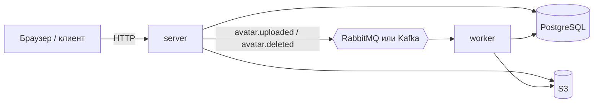
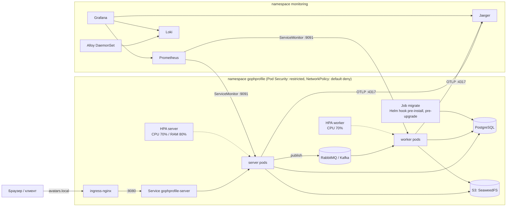

# Архитектура GophProfile

## Сервис

- **server** (`cmd/server`) — REST API и веб-интерфейс. Пишет метаданные в
  PostgreSQL и оригинал в S3, публикует событие и сразу отвечает клиенту.
- **worker** (`cmd/worker`) — читает события: создаёт миниатюры 100x100 и
  300x300, удаляет файлы удалённых аватарок. Обработка идемпотентна,
  временные ошибки повторяются (1, 2, 4 с), остальное уходит в DLQ.
- Брокер выбирается переменной `BROKER`; сервисы работают с интерфейсами
  `Publisher` и `Consumer` из `internal/broker`.

## Kubernetes

| Ресурс | server | worker | Общие |
| --- | --- | --- | --- |
| Deployment | requests/limits, envFrom ConfigMap и Secret, startup/liveness `/livez`, readiness `/health`, securityContext | то же, пробы на порту 9091 | — |
| Service (ClusterIP) | `http` 80→8080, `metrics` 9091 | `metrics` 9091 | — |
| Ingress | ingress-nginx, `proxy-body-size` | — | — |
| HorizontalPodAutoscaler | CPU 70%, RAM 80% | CPU 70% | — |
| PodDisruptionBudget | `minAvailable: 1` | `minAvailable: 1` | — |
| ServiceMonitor | ✅ | ✅ | `jobLabel: app` → job `avatar-service` / `avatar-worker` |
| ConfigMap, Secret | — | — | `gophprofile-config`, `gophprofile-secrets` (или `existingSecret`) |
| ServiceAccount | — | — | без токена API и без прав |
| NetworkPolicy | ingress-nginx → 8080, monitoring → 9091 | monitoring → 9091 | default deny; DNS, PostgreSQL, S3, брокер, OTLP |
| Job (Helm hook) | — | — | `server migrate up` |
| PrometheusRule, дашборды | — | — | алерты и 4 дашборда этапа 2 |

### Чарты

| Чарт | Что ставит |
| --- | --- |
| `deploy/helm/gophprofile` | server, worker, миграции, мониторинг, сетевые политики |
| `deploy/helm/gophprofile-infra` | PostgreSQL, S3 (SeaweedFS), RabbitMQ или Kafka для локального кластера. Отдельный релиз: хук миграций приложения запускается до его ресурсов, и база к этому моменту уже должна работать. В проде — управляемые сервисы, адреса в values |

### Порядок запуска и обновления

1. `helm upgrade --install gophprofile ...` — хуки `pre-install,pre-upgrade`:
   ServiceAccount и Secret (вес −10), затем Job миграций (вес 0).
2. Job упал → `helm upgrade` завершается ошибкой, Deployment не обновляется,
   старая версия работает на старой схеме. Миграции — только совместимые вперёд.
3. Rolling update: `maxSurge: 1`, `maxUnavailable: 0` — новый под проходит
   readiness до остановки старого.

### Graceful shutdown

|  | server | worker |
| --- | --- | --- |
| SIGTERM | `/health` → 503 `shutting_down`, через `SHUTDOWN_DELAY` (5 с) — `http.Server.Shutdown` с таймаутом 20 с | consumer перестаёт брать новые сообщения, текущее дорабатывается до 45 с |
| Незавершённое | Активные запросы дорабатывают, новые не приходят: под уже убран из Endpoints | Сообщение без ack (RabbitMQ) или без коммита offset (Kafka) доставится повторно, дубли гасит идемпотентность |
| Затем | Закрыть publisher, flush OTel, закрыть пул БД | Закрыть consumer, flush OTel, закрыть пул БД |
| `terminationGracePeriodSeconds` | 30 | 60 |
